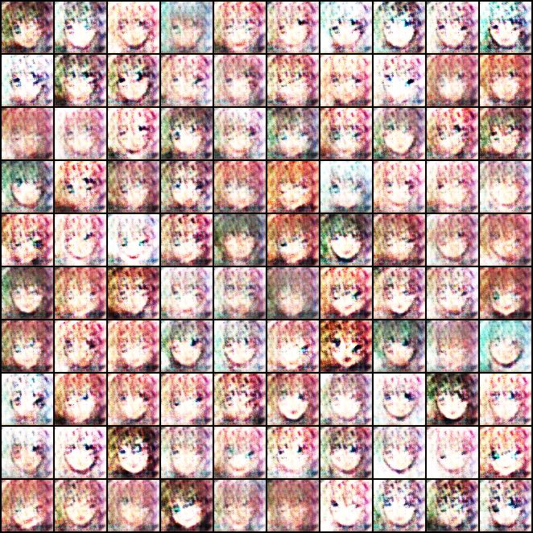
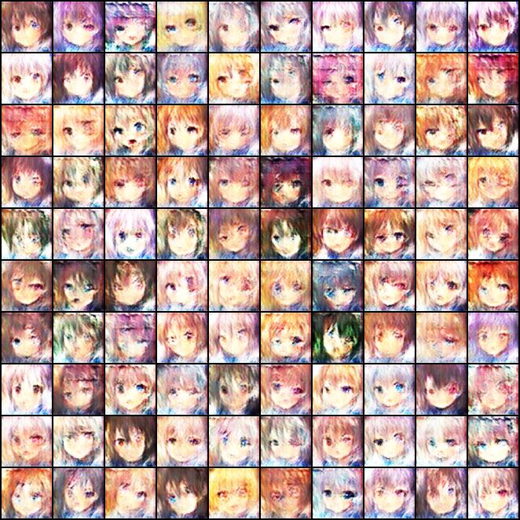
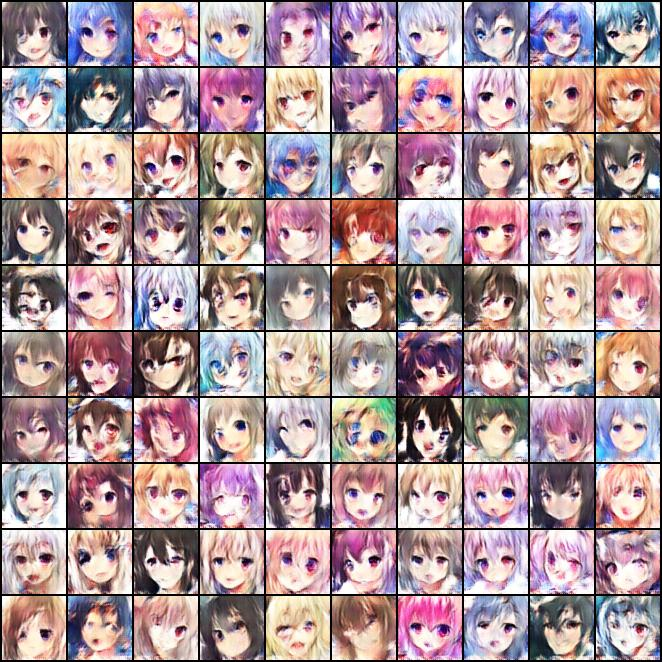

# HW4: Anime Face Generation (DCGAN)

Train a generative adversarial network to make 64x64 anime faces. The dataset is 71,314 anime face images, all 96x96 RGB, with no labels.

## Data

`CrypkoDataset` loads each image with `torchvision.io.read_image`, resizes it to 64x64 and maps it from [0, 1] to [-1, 1] so it matches the generator's Tanh output. At batch size 64 an epoch is 1,115 steps, and the last batch only has 18 images.

## Model

Generator (5,150,275 parameters): a 100-dim noise vector goes through `Linear(100, 8192)`, `BatchNorm1d`, `ReLU`, and is reshaped to 512 channels of 4x4. Then three `ConvTranspose2d` + `BatchNorm2d` + `ReLU` blocks (512 to 256 to 128 to 64 channels), each doubling the size, and a final `ConvTranspose2d` to 3 channels with `Tanh`. Size goes 4, 8, 16, 32, 64.

Discriminator (4,316,545 parameters): a stride-2 `Conv2d` with `LeakyReLU(0.2)`, then three `Conv2d` + `BatchNorm2d` + `LeakyReLU(0.2)` blocks (64 to 128 to 256 to 512 channels) that each halve the size, so 64 becomes 4x4. A 4x4 `Conv2d` turns that into one value per image, and `Sigmoid` makes it a probability of being real.

`BCELoss`, Adam for both networks with lr 1e-4 and betas (0.5, 0.999). The DCGAN paper uses beta1 = 0.5 because the default 0.9 made training oscillate. `n_critic` is 1, so G and D each get one update per step. 6 epochs, 6,690 steps.

## Results

There's no numeric target for this one; the output is the generated images. By epoch 6 the samples are clearly anime faces with a good spread of hair and eye colors, and all 100 in the fixed-noise grid look different, so no mode collapse. Common failures are mismatched eyes, smeared or lopsided faces and messy backgrounds.

| Epoch 1                         | Epoch 3                         | Epoch 6                   |
| ------------------------------- | ------------------------------- | ------------------------- |
|        |        |  |
| Blurry, pink-tinted, rough eyes | Recognizable but blurry, grainy | Sharper, stronger colors  |

Each grid renders the same 100 noise vectors, so the epochs line up one to one.

Losses at the last step of each epoch, from the progress bar:

| Epoch | Loss_D | Loss_G |
| ----- | ------ | ------ |
| 1     | 0.1791 | 4.8153 |
| 2     | 0.1837 | 6.6437 |
| 3     | 0.1155 | 5.1399 |
| 4     | 0.2956 | 4.8098 |
| 5     | 0.1189 | 3.2558 |
| 6     | 0.1566 | 3.7407 |

Each value is one batch of 18 images, so they're noisy, and GAN loss doesn't track image quality directly anyway. At every epoch end D's loss is low and G's is high, so the discriminator seems to have the upper hand, but the samples keep improving.

A few things about the provided code:

- Checkpoints only get saved when `(e+1) % 5 == 0 or e == 0`, i.e. after epochs 1 and 5. The epoch-6 weights are never saved, so the inference cells load the epoch-5 generator, and `result.jpg` (1,000 faces) is from epoch 5, not 6.
- The final 32-image preview uses `nrow=10`, so its last row has 2 faces and 8 empty black slots.
- The first "show some images" cell plots the raw [-1, 1] tensors, so matplotlib clips them and prints a warning. That's intentional; the next cell shifts them to [0, 1].
- More epochs would very likely help. The template suggests 20, but `n_epoch` isn't a TODO line, so it stayed at 6.

## Files

| File                 | Contents                                                                    |
| -------------------- | --------------------------------------------------------------------------- |
| `HW4.ipynb`          | The notebook with outputs. Summary and AI use disclosure are at the bottom. |
| `output/Epoch_*.jpg` | The fixed 100-sample grid after each of the 6 epochs.                       |
| `output/result.jpg`  | 1,000 faces from the saved (epoch-5) generator.                             |

The dataset (`HW4_Dataset.zip`) is not committed. It's 452 MB, over GitHub's 100 MB file limit, so it stays in Google Drive and is listed in `.gitignore`. It was provided with the assignment and unzips to a flat `faces/` folder of jpgs.

## Running it

Open in Colab on a GPU runtime (this run used an A100). Update the Drive path in the copy cell to wherever `HW4_Dataset.zip` lives, then Run All. It unzips to `./faces`, which is what `get_dataset` expects. Each epoch took about 30 seconds on the A100 (around 37 steps/s), so training was about 3 minutes total.

The seed is set with `same_seeds(6252002)` (a birthday in MMDDYYYY form, minus the leading zero, which Python 3 doesn't allow on an int literal), and cuDNN is put in deterministic mode. If you re-run the unzip cell in the same runtime it asks whether to replace the existing files; answering `A` is fine.

## AI Use Disclosure

Anthropic Claude Code was utilized on this assignment. Its contributions were: assistance with the explanatory comments next to updated TODO items and the summary. All code outside the TODO markers is the provided template, unmodified apart from the Google Drive copy and dataset unzip cells (fixed the zip path and file name). I personally modified, reviewed, and ran the final notebook.

## Documentation Referenced

Data loading:

- `torchvision.io.read_image` - https://pytorch.org/vision/stable/generated/torchvision.io.read_image.html
- `torchvision.transforms` - https://pytorch.org/vision/stable/transforms.html
- `torch.utils.data.DataLoader` - https://pytorch.org/docs/stable/data.html#torch.utils.data.DataLoader
- Python integer literals (no leading zeros) - https://docs.python.org/3/reference/lexical_analysis.html#integer-literals
- PyTorch reproducibility - https://pytorch.org/docs/stable/notes/randomness.html

Model:

- `nn.Linear` - https://pytorch.org/docs/stable/generated/torch.nn.Linear.html
- `nn.ConvTranspose2d` - https://pytorch.org/docs/stable/generated/torch.nn.ConvTranspose2d.html
- `nn.Conv2d` - https://pytorch.org/docs/stable/generated/torch.nn.Conv2d.html
- `nn.BatchNorm1d` - https://pytorch.org/docs/stable/generated/torch.nn.BatchNorm1d.html
- `nn.BatchNorm2d` - https://pytorch.org/docs/stable/generated/torch.nn.BatchNorm2d.html
- `nn.ReLU` - https://pytorch.org/docs/stable/generated/torch.nn.ReLU.html
- `nn.LeakyReLU` - https://pytorch.org/docs/stable/generated/torch.nn.LeakyReLU.html
- `nn.Tanh` - https://pytorch.org/docs/stable/generated/torch.nn.Tanh.html
- `nn.Sigmoid` - https://pytorch.org/docs/stable/generated/torch.nn.Sigmoid.html
- Generative Adversarial Networks - https://arxiv.org/abs/1406.2661
- DCGAN (Unsupervised Representation Learning with Deep Convolutional GANs) - https://arxiv.org/abs/1511.06434

Loss, training and output:

- `nn.BCELoss` - https://pytorch.org/docs/stable/generated/torch.nn.BCELoss.html
- `torch.optim.Adam` - https://pytorch.org/docs/stable/generated/torch.optim.Adam.html
- `torchvision.utils` (`make_grid`, `save_image`) - https://pytorch.org/vision/stable/utils.html
