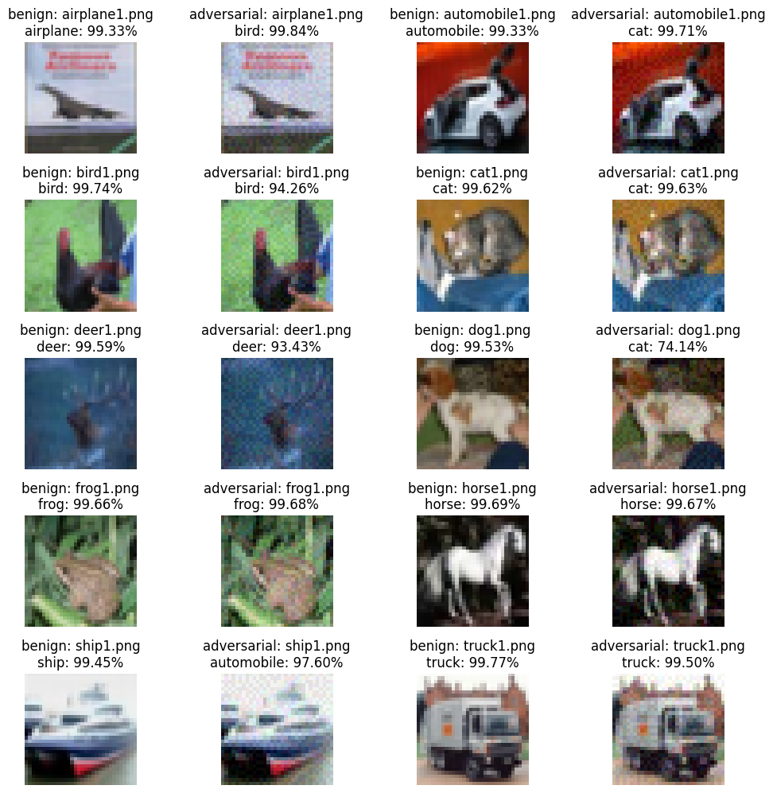

# HW6: Adversarial Attack (FGSM)

Fool a pretrained CIFAR-10 classifier with the Fast Gradient Sign Method, without changing any pixel by more than 8 out of 255. The target is 200 32x32 images, 20 for each of the 10 CIFAR-10 classes.

## Data

`data.zip` unzips to `data/<class>/<class>N.png`. `AdvDataset` labels each image by its folder in sorted order, which matches the CIFAR-10 class order. The transform is `ToTensor` and then `Normalize` with the CIFAR-10 mean (0.491, 0.482, 0.447) and std (0.202, 0.199, 0.201). The loader uses batch size 8 and `shuffle=False`, which matters because `create_dir` matches the adversarial images to `adv_names` by position.

## Model

`resnet110_cifar10` from [pytorchcv](https://pypi.org/project/pytorchcv/), pretrained, in eval mode. Cross entropy loss.

## Attack

The budget is 8 in 0-255 pixel space, but the attack works on normalized tensors, so epsilon is `8/255/std`, one value per channel: 0.1553, 0.1577, 0.1561.

FGSM is a single step. With `requires_grad` set on a copy of the input, it backprops the loss to the image and adds `epsilon * grad.sign()`, so every pixel moves by the full budget in whichever direction raises the loss. `gen_adv_examples` undoes the normalization, clamps to [0, 255], rounds, and transposes (N, C, H, W) to (N, H, W, C) so PIL can save the images to `fgsm/`, which then gets packed into `fgsm.tgz`.

## Results

|        | Accuracy | Loss    |
| ------ | -------- | ------- |
| Benign | 0.95000  | 0.22678 |
| FGSM   | 0.59000  | 2.49215 |

The model gets 190 of 200 benign images right and 118 after the attack. That's 72 correct predictions flipped and none of the 10 misses fixed. The loss goes up about 11x.

To make sure rounding and clamping didn't break anything, I compared the saved PNGs to the originals. The largest pixel change in every image is exactly 8, and classifying the saved PNGs again also gives 118/200.

| Class      | Benign | FGSM |
| ---------- | ------ | ---- |
| airplane   | 20     | 7    |
| automobile | 19     | 12   |
| bird       | 17     | 13   |
| cat        | 19     | 13   |
| deer       | 18     | 8    |
| dog        | 19     | 6    |
| frog       | 19     | 16   |
| horse      | 20     | 13   |
| ship       | 20     | 16   |
| truck      | 19     | 14   |

Four of the ten examples change class: airplane to bird (99.84%), automobile to cat (99.71%), dog to cat (74.14%) and ship to automobile (97.60%). Most of the wrong answers come with very high confidence. The noise is a faint grain that is easiest to see in flat regions like the sky behind the airplane and ship, and every image is still obviously what it was.

FGSM is the weakest attack of its kind since it only takes one step. The template defines `alpha` and has commented-out `ifgsm` lines, so an iterative version (several alpha-sized steps, clipping back into the epsilon ball each time) would be the natural next step and should push accuracy far lower. It isn't a TODO, so it isn't in the notebook.

## Files

| File                | Contents                                                                    |
| ------------------- | --------------------------------------------------------------------------- |
| `HW6.ipynb`         | The notebook with outputs. Summary and AI use disclosure are at the bottom. |
| `visualization.png` | Benign vs adversarial predictions for the first image of each class.        |
| `fgsm.tgz`          | All 200 FGSM adversarial images, in the same class folders as `data/`.      |
| `data.zip`          | The 200 benign images (490 KB), provided with the assignment.               |

## Running it

Open in Colab on a GPU runtime (this run used a T4). Update the Drive path in the unzip cell to wherever `data.zip` lives, then Run All. It unzips to `/content/data`, which is what `root = './data'` expects. The pretrained weights download from the pytorchcv GitHub releases the first time the model cell runs. The whole notebook runs in well under a minute.

There's no randomness in FGSM or in the eval-mode model, so the numbers should reproduce exactly.

## AI Use Disclosure

Anthropic Claude Code was utilized on this assignment. Its contributions were: assistance with the explanatory comments next to updated TODO items and the summary. All code outside the TODO markers is the provided template, unmodified apart from the Google Drive mount and dataset unzip cells. I personally modified, reviewed, and ran the final notebook.

## Documentation Referenced

Data loading:

- `torchvision.transforms` (`ToTensor`, `Normalize`) - https://pytorch.org/vision/stable/transforms.html
- `torch.utils.data.DataLoader` - https://pytorch.org/docs/stable/data.html#torch.utils.data.DataLoader
- `numpy.transpose` - https://numpy.org/doc/stable/reference/generated/numpy.transpose.html
- `PIL.Image.fromarray` - https://pillow.readthedocs.io/en/stable/reference/Image.html#PIL.Image.fromarray

Model:

- pytorchcv - https://pypi.org/project/pytorchcv/
- `nn.Module.eval` - https://pytorch.org/docs/stable/generated/torch.nn.Module.html#torch.nn.Module.eval
- Deep Residual Learning for Image Recognition - https://arxiv.org/abs/1512.03385

Attack:

- `nn.CrossEntropyLoss` - https://pytorch.org/docs/stable/generated/torch.nn.CrossEntropyLoss.html
- `Tensor.requires_grad` - https://pytorch.org/docs/stable/generated/torch.Tensor.requires_grad.html
- `Tensor.backward` - https://pytorch.org/docs/stable/generated/torch.Tensor.backward.html
- `torch.sign` - https://pytorch.org/docs/stable/generated/torch.sign.html
- Explaining and Harnessing Adversarial Examples (FGSM) - https://arxiv.org/abs/1412.6572
- Adversarial Examples in the Physical World (I-FGSM) - https://arxiv.org/abs/1607.02533
